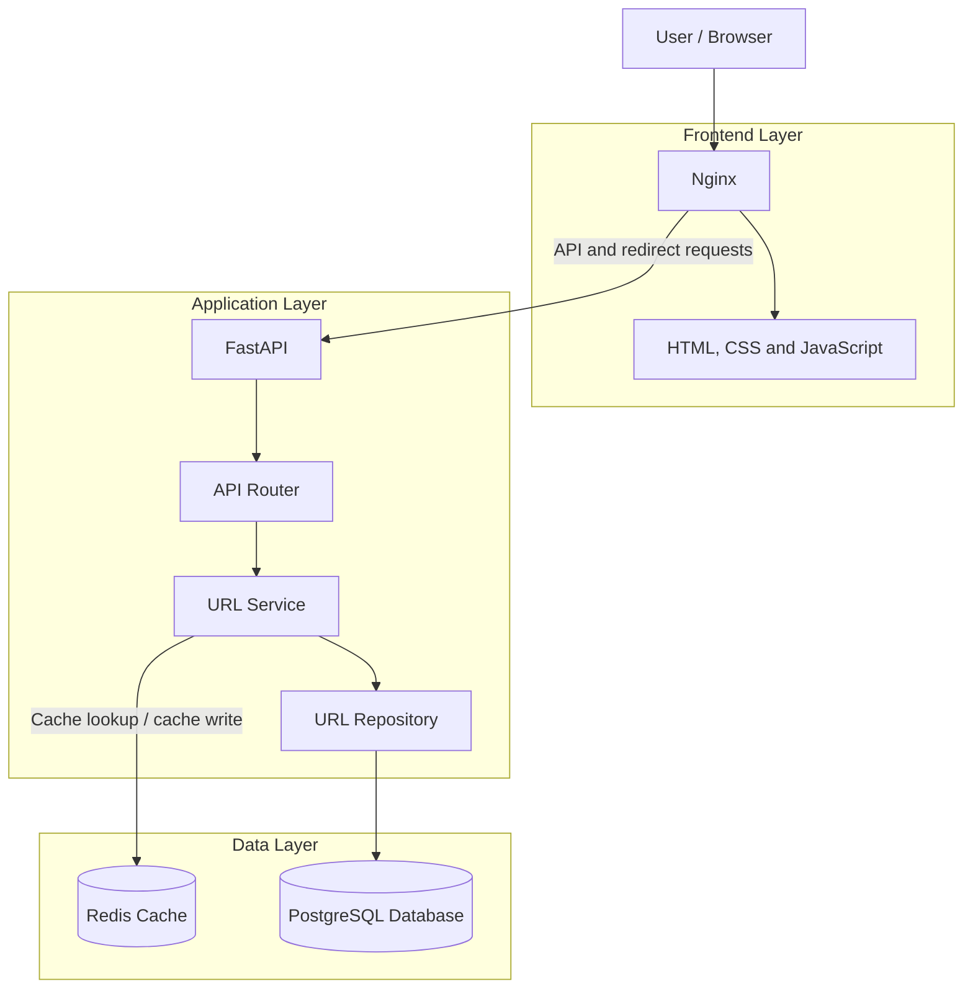
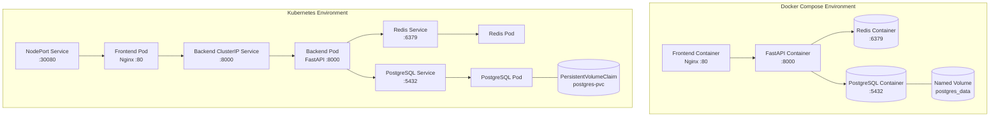
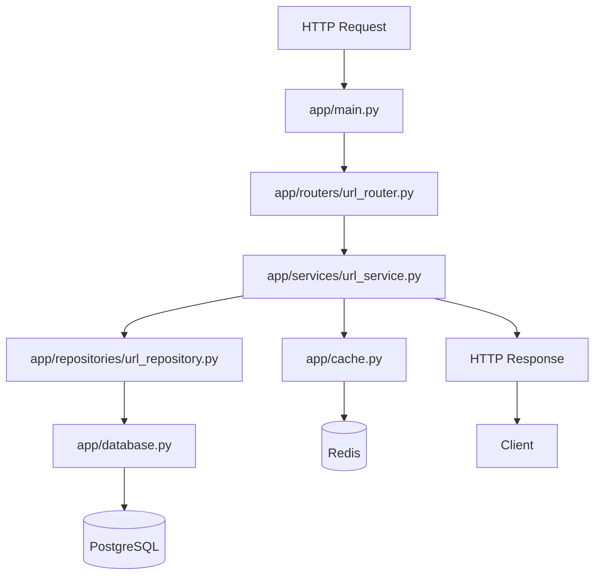
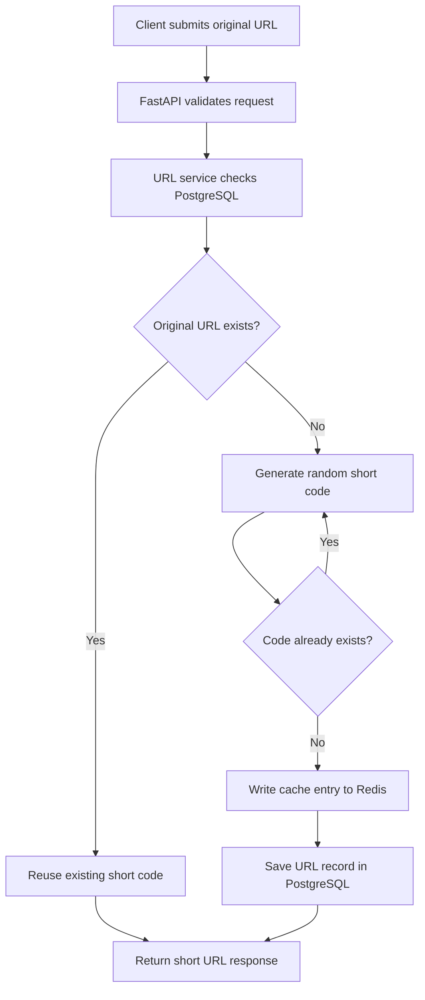
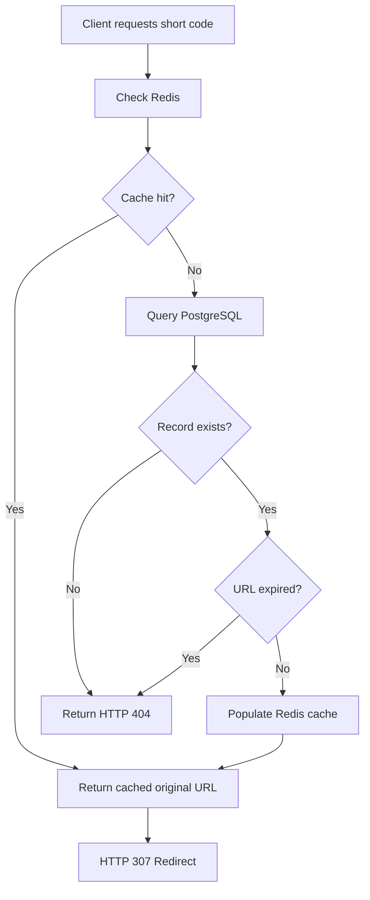
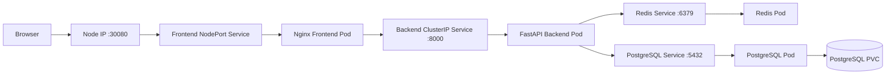

# URL Shortener | FastAPI, Redis, PostgreSQL, Docker & Kubernetes

A containerized URL-shortening service built with **FastAPI, PostgreSQL, Redis, Docker, Nginx, and Kubernetes**. This project explores backend service design, cache-aside architecture, container networking, Kubernetes orchestration, persistent storage, health probes, and infrastructure troubleshooting.

The goal is not just to shorten URLs, but to understand how an application and its dependencies operate together, how failures propagate across components, and how to diagnose and improve system reliability.

## Table of Contents

- [Project Overview](#project-overview)
- [Architecture](#architecture)
- [Technology Stack](#technology-stack)
- [Application Design](#application-design)
- [Request Lifecycle](#request-lifecycle)
- [Caching Strategy](#caching-strategy)
- [Docker and Containerization](#docker-and-containerization)
- [Kubernetes Architecture](#kubernetes-architecture)
- [Networking and Traffic Flow](#networking-and-traffic-flow)
- [Health Checks and Persistence](#health-checks-and-persistence)
- [Running the Project with Docker Compose](#running-the-project-with-docker-compose)
- [Deploying to Kubernetes](#deploying-to-kubernetes)
- [Testing and Troubleshooting](#testing-and-troubleshooting)
- [Reliability Considerations and Future Improvements](#reliability-considerations-and-future-improvements)
- [Key Engineering Learnings](#key-engineering-learnings)
- [Project Structure](#project-structure)

---

## Project Overview

This project implements a URL shortener that converts a long URL into a compact, shareable link. When someone accesses the generated link, the application resolves the short code and redirects them to the original destination.

Beyond the core functionality, the project explores how to package, run, connect, and manage a multi-component application using Docker and Kubernetes.

### Key Features

- Create short URLs through a REST API.
- Generate random seven-character alphanumeric short codes.
- Reuse an existing short code when the same original URL is submitted again.
- Resolve short codes and redirect users using HTTP `307 Temporary Redirect`.
- Cache URL lookups in Redis with a 24-hour TTL.
- Fall back to PostgreSQL when a cached URL is unavailable.
- Enforce URL expiration using a database timestamp.
- Provide a lightweight HTML, CSS, and JavaScript frontend.
- Use Nginx to serve frontend assets and proxy requests to the backend.
- Run the application stack using Docker Compose.
- Deploy the application components using Kubernetes Deployments and Services.
- Use Kubernetes readiness and liveness probes for application health management.
- Use a PersistentVolumeClaim for PostgreSQL storage.

## Architecture

### 1. High-Level System Architecture

The application separates the user-facing interface, API layer, business logic, caching layer, and persistent storage.



**Component responsibilities**

| Component | Responsibility |
|---|---|
| Nginx | Serves static frontend files and reverse-proxies requests to FastAPI. |
| FastAPI | Exposes HTTP endpoints and handles request validation and HTTP responses. |
| URL router | Defines the URL creation and redirection endpoints. |
| URL service | Implements short-code generation workflow, deduplication, cache lookup, expiration checks, and coordination between storage layers. |
| URL repository | Encapsulates PostgreSQL queries and persistence operations using SQLAlchemy. |
| Redis | Provides fast access to cached short-code-to-URL mappings. |
| PostgreSQL | Stores durable URL records and their expiration timestamps. |
| Docker | Packages the backend and frontend into container images. |
| Docker Compose | Runs the multi-container development environment. |
| Kubernetes | Manages application workloads, service discovery, health probes, and persistent storage. |

### 2. Deployment Architecture

The project supports two deployment approaches: Docker Compose for local multi-container execution and Kubernetes for container orchestration.



The Compose and Kubernetes environments are alternative ways to run the application, not two environments that must run simultaneously.

---

## Technology Stack

| Technology | How it is used |
|---|---|
| Python | Backend implementation and business logic |
| FastAPI | REST API framework |
| Pydantic | Request validation |
| SQLAlchemy | ORM and database access |
| PostgreSQL 16 | Persistent URL records |
| Redis 7 | URL lookup cache with TTL |
| Alembic | Database schema migrations |
| Uvicorn | ASGI application server |
| HTML, CSS, JavaScript | Frontend interface |
| Nginx | Static-file serving and reverse proxy |
| Docker | Container image creation |
| Docker Compose | Multi-container local environment |
| Kubernetes | Deployments, Services, probes, and storage |
| Minikube | Local Kubernetes development cluster |

## Application Design

The backend uses a layered structure to separate HTTP handling, business logic, and database operations.



### Layer Responsibilities

**Router layer — `app/routers/url_router.py`**

Defines the API endpoints, receives validated inputs, calls the service layer, and converts service results into HTTP responses.

**Service layer — `app/services/url_service.py`**

Implements the main application behavior, including short-code generation, original-URL deduplication, cache lookups, expiration checks, and database fallback.

**Repository layer — `app/repositories/url_repository.py`**

Provides functions for saving URL records, retrieving records by short code, checking code existence, and finding records by original URL.

**Model and schema layers — `app/models.py` and `app/schemas.py`**

The SQLAlchemy model defines the database representation, while the Pydantic schema validates incoming request data.

**Infrastructure access — `app/database.py` and `app/cache.py`**

Initialize the PostgreSQL connection engine and Redis client using environment-based configuration.

This separation improves maintainability and makes individual components easier to test and debug.

## Request Lifecycle

### 1. Creating a Short URL

Endpoint: `POST /shorten`



The service first checks whether the original URL has already been stored. If a matching record exists, its short code is reused. Otherwise, a new code is generated and checked for collisions before being stored.

A successful request returns HTTP `201 Created`, together with the original URL, short code, and relative short URL.

Example request:

```http
POST /shorten
Content-Type: application/json
```

```json
{
  "url": "https://www.example.com"
}
```

Example response shape:

```json
{
  "original_url": "https://www.example.com/",
  "short_code": "4txZuwy",
  "short_url": "/4txZuwy"
}
```

The actual response depends on URL normalization and the generated code.

### 2. Resolving a Short URL

Endpoint: `GET /{short_code}`



When the cache contains a valid mapping, the service can avoid a database lookup. On a cache miss, PostgreSQL provides the durable record, and the service can repopulate Redis for subsequent requests.

Unknown or expired links should return HTTP `404 Not Found`. Valid links return HTTP `307 Temporary Redirect`.

---

## Caching Strategy

The project uses a **cache-aside pattern**.

Redis is checked first, and PostgreSQL acts as the persistent source of truth.

### Cache Hit

1. The client requests a short URL.
2. The service looks up the short code in Redis.
3. Redis returns the original URL.
4. The service returns the URL for redirection without querying PostgreSQL.

### Cache Miss

1. Redis does not contain the requested key.
2. The service queries PostgreSQL.
3. The service checks whether the record exists and has expired.
4. If valid, the original URL is added back to Redis.
5. The request continues to the redirect response.

### TTL and Expiration

The Redis cache uses a 24-hour TTL:

```python
TTL = 24 * 60 * 60
```

This equals 86,400 seconds.

There are two distinct expiration mechanisms:

- **Redis TTL:** controls how long a cached entry remains in Redis.
- **Database `expires_at`:** controls the intended lifetime of the shortened URL.

The database expiration timestamp must remain authoritative. Cache hits and URL-creation requests must also enforce expiration to prevent expired links from being served or recached.

### Why Redis and PostgreSQL?

Redis is optimized for fast key-value access. PostgreSQL provides durable, structured records.

Using both illustrates a common backend and distributed-systems design pattern: a fast cache in front of a persistent data store.

It also introduces consistency considerations. Cache updates and database writes can fail independently, so production implementations need explicit error handling and a defined consistency strategy.

---

## Docker and Containerization

The project uses separate Docker images for the Python backend and the Nginx frontend.

### Backend Dockerfile

The root `Dockerfile`:

1. Starts from a slim Python base image.
2. Sets `/app` as the working directory.
3. Copies the dependency manifest.
4. Installs Python dependencies.
5. Copies the application source.
6. Documents port `8000`.
7. Starts Uvicorn bound to `0.0.0.0`.

Copying `requirements.txt` before the source code allows Docker to reuse the dependency installation layer when application files change.

Binding to `0.0.0.0` allows traffic arriving through the container's network interfaces to reach Uvicorn.

### Frontend Dockerfile

The frontend image:

- Uses `nginx:alpine`.
- Copies static frontend assets into Nginx's document root.
- Installs the project's Nginx configuration.
- Serves the frontend on port `80`.

### Docker Compose

`docker-compose.yml` defines four services:

| Service | Purpose | Port |
|---|---|---|
| `frontend` | Nginx frontend and reverse proxy | Host `3000` → container `80` |
| `app` | FastAPI backend | Host `8000` → container `8000` |
| `postgres` | Persistent URL storage | Container `5432` |
| `redis` | Cache | Container `6379` |

The backend uses the Compose service names `postgres` and `redis` as internal DNS hostnames.

PostgreSQL uses a named volume, `postgres_data`, so ordinary container replacement does not automatically remove its stored database files.

Redis is treated as a cache and does not have a dedicated persistence volume in the current Compose configuration.

### Useful Docker Commands

```bash
# Build images
docker compose build

# Start the stack
docker compose up -d

# Build and start after code changes
docker compose up -d --build

# Inspect service status
docker compose ps

# Follow backend logs
docker compose logs -f app

# Check Redis connectivity
docker compose exec redis redis-cli ping

# Inspect a cached URL
docker compose exec redis redis-cli GET 4txZuwy

# Inspect the remaining TTL
docker compose exec redis redis-cli TTL 4txZuwy

# Stop and remove containers and network
docker compose down
```

Note: `docker compose down -v` also removes Compose-managed named volumes and can delete local PostgreSQL data.

---

## Kubernetes Architecture

The `k8s/` directory contains manifests for the backend, frontend, PostgreSQL, and Redis.

The project uses Kubernetes resources to describe the desired state of each component rather than manually managing individual containers.

### Backend — `k8s/backend.yaml`

Defines a Deployment and a ClusterIP Service.

The Deployment requests one backend replica, runs the FastAPI image on port `8000`, and injects `DATABASE_URL` and `REDIS_URL` through environment variables.

The Service provides a stable internal endpoint named `url-shortener-app`.

The manifest configures:

- A readiness probe against `/ready`.
- A liveness probe against `/health`.

The readiness probe controls whether the Pod should receive normal Service traffic. The liveness probe helps Kubernetes detect an application container that should be restarted.

### Frontend — `k8s/frontend.yaml`

Defines the Nginx frontend Deployment and a NodePort Service.

The frontend is exposed through NodePort `30080`, providing an entry point to the application when the node and network are reachable.

The Nginx configuration proxies API and short-code requests to the backend Service.

### PostgreSQL — `k8s/postgres.yaml`

Defines:

- A PersistentVolumeClaim requesting `1Gi` of storage.
- A PostgreSQL Deployment using `postgres:16`.
- An internal Service named `postgres`.

The PVC is mounted at PostgreSQL's data directory. This allows database data to survive ordinary Pod replacement, subject to the underlying storage configuration and retention.

### Redis — `k8s/redis.yaml`

Defines a Redis Deployment and an internal Service named `redis`.

The Redis readiness probe executes `redis-cli ping`. The backend accesses Redis through the stable Service name rather than a Pod IP.

### Kubernetes Networking



The frontend is the intended entry point. The backend, Redis, and PostgreSQL Services are intended for internal cluster communication.

A NodePort does not guarantee access from another computer. The node IP, firewall rules, VM networking, and any required port forwarding must also permit the connection.

### Image Management

The application Deployments currently use local image names and `imagePullPolicy: Never`.

Consequently, the images must already be available to the Minikube node. Building an image on the host does not automatically guarantee that Minikube can use it.

A typical local workflow is:

```bash
# Build the application images
docker build -t url-shortener-app:latest .
docker build -t url-shortener-frontend:latest ./frontend

# Start Minikube if required
minikube start --driver=docker

# Make images available to Minikube
minikube image load url-shortener-app:latest
minikube image load url-shortener-frontend:latest

# Apply the manifests
kubectl apply -f k8s/postgres.yaml
kubectl apply -f k8s/redis.yaml

# Apply the application components
kubectl apply -f k8s/backend.yaml
kubectl apply -f k8s/frontend.yaml
```

Apply database schema migrations before relying on the application in a fresh environment. The current manifests do not define a dedicated migration Job.

### Kubernetes Inspection Commands

```bash
# Verify the current cluster context
kubectl config current-context

# Inspect nodes
kubectl get nodes

# Inspect workloads
kubectl get deployments
kubectl get pods -o wide
kubectl get services

# Inspect persistent storage
kubectl get pvc

# Read backend logs
kubectl logs deployment/url-shortener-app

# Inspect a failing Pod
kubectl describe pod <pod-name>

# Check frontend access
minikube service url-shortener-frontend --url

# Access the application through a local port forward
kubectl port-forward service/url-shortener-frontend 8080:80
```

The final command provides local access at `http://localhost:8080` while the port-forward process remains active.

---

## Networking and Traffic Flow

The project uses different networking mechanisms at different layers.

| Layer | Mechanism | Purpose |
|---|---|---|
| Browser to frontend | Host port mapping or NodePort | Makes the frontend reachable |
| Frontend to backend | Nginx reverse proxy | Forwards API and short-code requests |
| Container-to-container | Docker Compose DNS | Resolves Compose service names |
| Pod-to-Pod application access | Kubernetes Service DNS | Provides stable internal service endpoints |
| Backend to PostgreSQL | SQLAlchemy and PostgreSQL protocol | Reads and writes durable URL records |
| Backend to Redis | Redis client protocol | Reads and writes cached URL mappings |

Nginx maps `/api/shorten` to the backend's `/shorten` endpoint through its proxy configuration. Short-code paths such as `/4txZuwy` are forwarded to FastAPI for resolution.

The frontend constructs the displayed short URL using the current browser origin and the relative path returned by the backend. This avoids hardcoding `localhost` into generated links.

---

## Health Checks and Persistence

Health checks and persistent storage serve different reliability purposes.

### Application Health

- `/health` is intended as a lightweight liveness endpoint.
- `/ready` checks PostgreSQL connectivity and is intended as a readiness endpoint.

The readiness endpoint must have its required imports and error handling fixed and tested before relying on the probe configuration.

A successful health endpoint does not prove that every dependency is healthy. For example, the current `/health` endpoint does not test Redis or PostgreSQL.

### Database Persistence

Docker Compose uses the named volume `postgres_data`.

Kubernetes uses the `postgres-pvc` PersistentVolumeClaim.

Both configurations separate database storage from the lifecycle of an individual application container or Pod. They do not, by themselves, provide database replication, backups, or disaster recovery.

---

## Running the Project with Docker Compose

### Prerequisites

- Docker Engine
- Docker Compose
- Git

### Setup

Clone the repository:

```bash
git clone <YOUR_GITHUB_REPOSITORY_URL>
cd <YOUR_REPOSITORY_DIRECTORY>
```

Build and start the services:

```bash
docker compose up -d --build
```

Inspect the containers:

```bash
docker compose ps
docker compose logs -f app
```

If this is a fresh database, apply the project's Alembic migration before testing the URL endpoints. The current Dockerfile does not execute migrations automatically.

Open the frontend:

```text
http://localhost:3000
```

The API is also published on host port `8000` by the current Compose configuration.

### API Example

```bash
curl -i -X POST http://localhost:8000/shorten \
  -H "Content-Type: application/json" \
  -d '{"url":"https://www.example.com"}'
```

Use the returned short code to test the redirect:

```bash
curl -i http://localhost:8000/<SHORT_CODE>
```

A successful resolution should return HTTP `307` with a `Location` header containing the original URL.

---

## Testing and Troubleshooting

Testing should validate both the successful request path and the failure paths.

### Functional Tests

| Test | Expected behavior |
|---|---|
| Submit a valid URL | Returns HTTP `201` and a short code |
| Submit the same original URL again | Reuses the existing code |
| Resolve a valid short code | Returns HTTP `307` |
| Resolve an unknown short code | Returns HTTP `404` |
| Delete a cache entry and resolve the code | Falls back to PostgreSQL and repopulates Redis |
| Resolve an expired URL | Returns HTTP `404`, including when a stale cache entry exists |
| PostgreSQL becomes unavailable | Readiness check fails |
| Restart the PostgreSQL container or Pod | Data survives if its persistent volume is retained |

These are expected test outcomes; they should be verified against the current code rather than assumed to pass.

### Troubleshooting Workflow

**1. Backend does not start**

```bash
docker compose logs app
```

Inspect Python import errors, syntax errors, dependency installation, and environment variables before investigating networking.

**2. Redis cache miss returns an error**

```bash
docker compose exec redis redis-cli PING
docker compose exec redis redis-cli GET <SHORT_CODE>
docker compose exec redis redis-cli TTL <SHORT_CODE>
```

Confirm Redis is available, then inspect the backend logs and verify that PostgreSQL fallback and expiry checks work.

**3. Kubernetes Pod is not starting**

```bash
kubectl get pods
kubectl describe pod <pod-name>
kubectl logs <pod-name>
```

Check image availability, environment variables, Service names, startup errors, and probe failures.

**4. Frontend is reachable but the API fails**

Inspect the Nginx proxy configuration, backend Service selectors, Pod readiness, and the path forwarded to FastAPI.

**5. NodePort is unreachable from another machine**

Verify the NodePort Service, node IP, host and VM network path, firewall rules, and any required port forwarding. Internal Kubernetes connectivity alone does not prove external reachability.

---

## Reliability Considerations and Future Improvements

The project is a learning and development deployment, not a claim of production readiness. The following improvements are important next steps.

### 1. Correct Expiration Handling

Ensure expiration is checked on both cache hits and cache misses, and before reusing an existing URL record. Prevent expired records from being returned or recached.

### 2. Make Cache and Database Writes More Resilient

Define the behavior when Redis or PostgreSQL is unavailable. Handle database write failures and code collisions safely, and avoid treating the cache as the source of truth.

### 3. Automate Database Migrations

Introduce a documented migration step or Kubernetes Job so the required schema exists before the backend serves requests in a fresh environment.

### 4. Improve Configuration and Secret Management

Move credentials out of committed manifests and use environment-specific configuration and Kubernetes Secrets or an external secret manager. Restrict CORS to the required origins.

### 5. Add Automated Tests

Introduce unit and integration tests for URL validation, deduplication, cache hits, cache misses, expiry, database failures, and HTTP redirect behavior.

### 6. Improve Observability

Add structured logs, request latency measurements, error rates, and dependency health information. A future extension could expose application metrics for Prometheus and dashboards in Grafana.

### 7. Strengthen Kubernetes Reliability

Evaluate resource requests and limits, startup probes where appropriate, dependency readiness, replica behavior, and graceful shutdown. For production persistence, add backup and recovery procedures and evaluate an appropriate managed database or highly available storage design.

### 8. Improve Image Delivery

Use versioned image tags and a container registry for repeatable deployments. Replace local-only image assumptions with an explicit build and release workflow.

### 9. Address Concurrency and Scalability

Handle concurrent short-code creation safely using the database uniqueness constraint and retry logic. Evaluate connection-pool behavior, cache failure modes, and the effects of multiple backend replicas.

These are planned improvements, not capabilities that should be assumed to exist in the current implementation.

---

## Key Engineering Learnings

This project provided practical exposure to several concepts relevant to backend engineering and Site Reliability Engineering:

- **Service architecture:** separating API handling, business logic, and persistence.
- **Caching:** implementing cache-aside lookups, TTLs, database fallback, and cache repopulation.
- **Containerization:** building separate frontend and backend images and managing runtime configuration.
- **Container networking:** understanding service DNS, port mappings, reverse proxies, and container interfaces.
- **Kubernetes orchestration:** deploying workloads, exposing Services, configuring probes, and managing persistent storage.
- **Debugging:** tracing failures through application logs, Redis state, database behavior, Pod events, and networking layers.
- **Reliability engineering:** identifying failure modes, distinguishing liveness from readiness, and understanding the limits of health checks and persistence.
- **Operational thinking:** validating recovery paths rather than testing only successful requests.

The central engineering lesson is that a service is only as reliable as the interactions between its components. Understanding those interactions is essential for diagnosing failures and designing systems that are easier to operate.

---

## Project Structure

```text
url-shortener/
├── app/
│   ├── main.py
│   ├── config.py
│   ├── database.py
│   ├── cache.py
│   ├── models.py
│   ├── schemas.py
│   ├── routers/
│   │   └── url_router.py
│   ├── services/
│   │   └── url_service.py
│   ├── repositories/
│   │   └── url_repository.py
│   └── utils/
│       └── shortener.py
├── frontend/
│   ├── Dockerfile
│   ├── index.html
│   ├── style.css
│   ├── script.js
│   └── nginx.conf
├── alembic/
│   ├── env.py
│   └── versions/
├── k8s/
│   ├── backend.yaml
│   ├── frontend.yaml
│   ├── postgres.yaml
│   └── redis.yaml
├── Dockerfile
├── docker-compose.yml
├── requirements.txt
├── alembic.ini
├── .dockerignore
└── .gitignore
```

## Author

**Deeksha K G**

This project is part of my hands-on learning in backend systems, Docker, Kubernetes, and Site Reliability Engineering.

[GitHub Repository](<https://github.com/deeksha-kg/url-shortener>)
